# Sheels

**Recriação do [Caelestia Shell](https://github.com/caelestia-dots/shell) para o compositor [driftwm](https://github.com/malbiruk/driftwm)**, renderizada com [EWW](https://github.com/elkowar/eww) e movida por um daemon em **Rust**, empacotada para **NixOS** (flake + módulos NixOS e Home-Manager).

O Caelestia original é feito em QML/Quickshell e só roda no Hyprland. O Sheels reproduz o visual e as funções dele (barra, moldura da tela, dashboard, launcher, notificações, OSD, sessão, sidebar, utilitários, popouts, lock, o app de configurações **Nexus**, tema Material You gerado do wallpaper) sobre o driftwm, que é um compositor de canvas infinito, gastando muito menos memória.

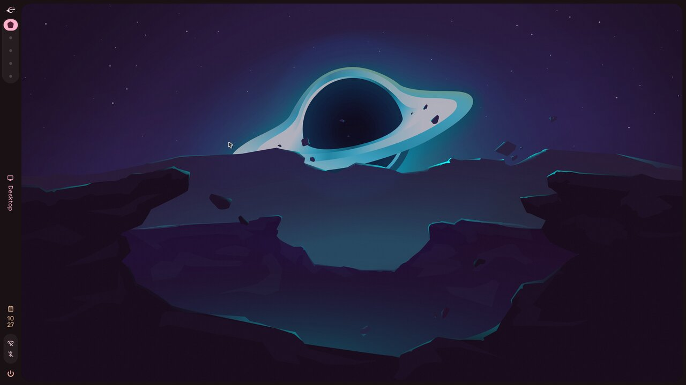

| Dashboard | Launcher |
|---|---|
| 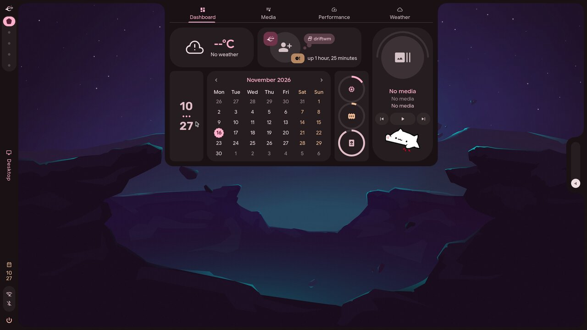 | 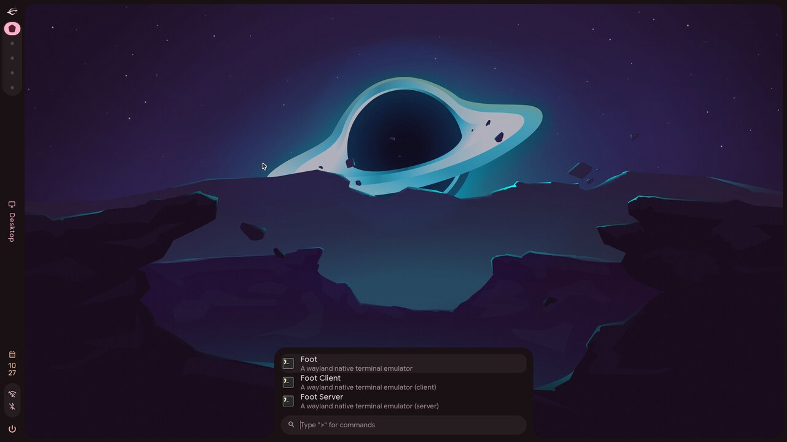 |
| **Sidebar + utilitários** | **Menu de sessão** |
| 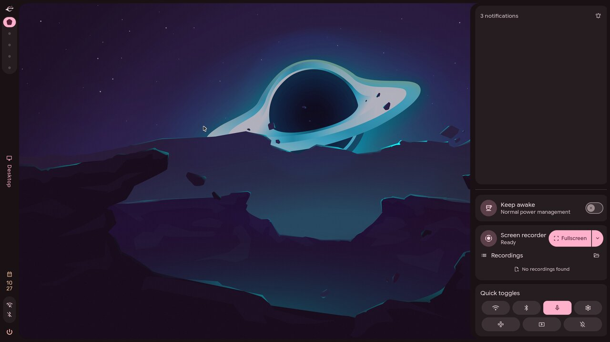 | 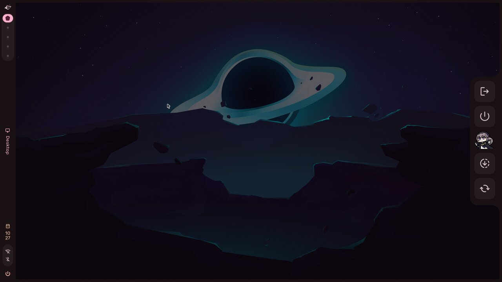 |
| **Tela de bloqueio** | **Notificação** |
| 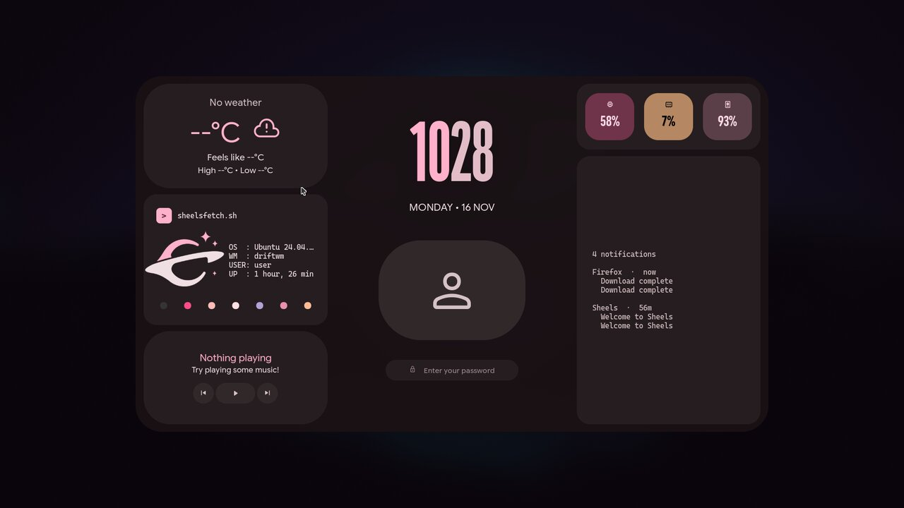 | 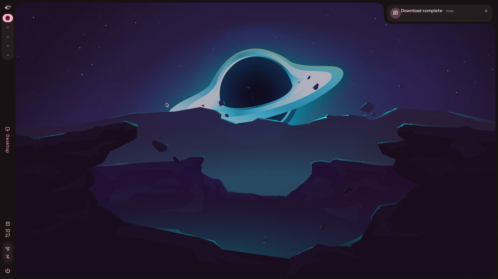 |
| **Popout da barra** | **Performance** |
| 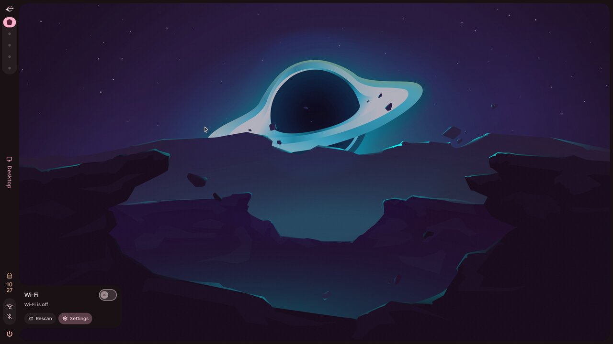 | 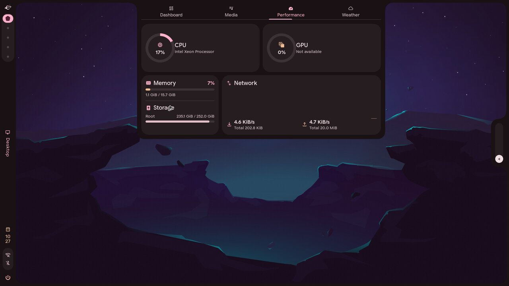 |
| **Nexus (configurações)** | **Nexus → Taskbar** |
| 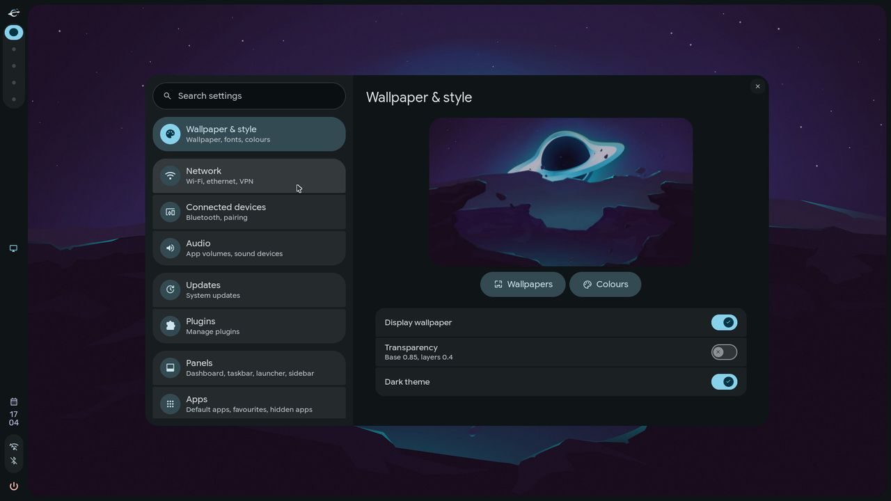 | 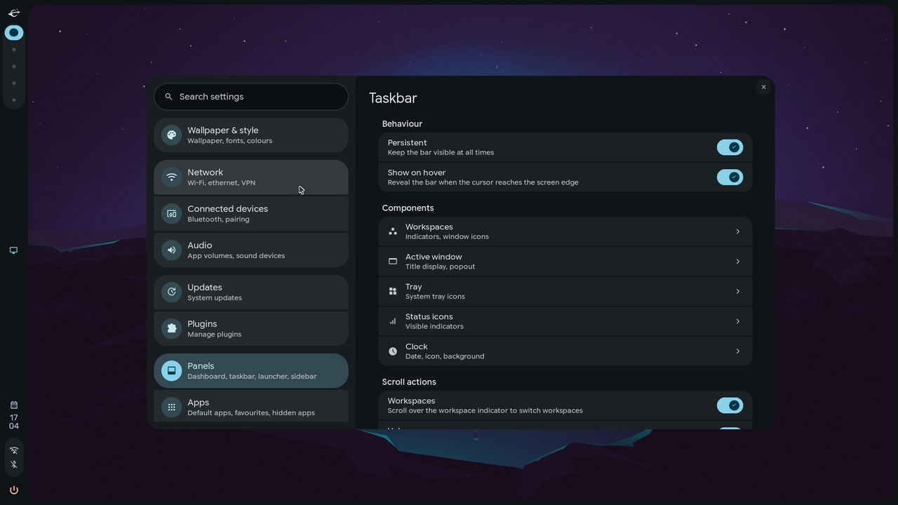 |

> Todas as capturas acima vieram do Sheels rodando de verdade (driftwm aninhado, renderização por software). Elas foram comparadas lado a lado com o Caelestia v2.5 original nas mesmas condições.

---

## Desempenho

Medido com toda a stack aberta (daemon + EWW + listeners) a 1920×1080. A renderização foi por software (llvmpipe), então com GPU real os números são ainda menores.

| Situação | CPU (1 núcleo) | Memória (PSS) |
|---|---|---|
| Ocioso (barra + moldura) | **~0,12 %** | **~55 MiB** |
| Dashboard aberto na aba Performance (recursos a cada 1 s) | ~0,47 % | ~67 MiB |

O consumo é baixo por causa destas escolhas:

- **Tudo é orientado a eventos.** Não há polling para áudio (`pactl subscribe`), rede e Bluetooth (sinais D-Bus do NetworkManager e do BlueZ), mídia (MPRIS), brilho (`poll(POLLPRI)` no sysfs) nem para o driftwm (IPC `subscribe`, limitado a 20 Hz).
- **O monitor de recursos só roda com o dashboard aberto.** Fechado, ele dorme num `Notify`.
- **A posição da música não exige ticks do daemon.** O daemon publica `(posição, timestamp)` e o EWW interpola com `EWW_TIME`.
- **Janelas só existem quando visíveis.** Cada painel é mapeado ao abrir e destruído ao fechar.
- **O EWW só mexe no GTK quando um valor muda de verdade.** O EWW original chama todos os setters a cada atualização de variável, mesmo com o valor igual (e um `label.set_text` igual já força relayout da janela), e recria todos os filhos de um `for`. O patch do Sheels (`nix/eww-sheels.patch`) memoriza o último valor de cada propriedade e de cada lista. Resultado medido: **~8× menos CPU no EWW** por atualização de status (100 atualizações: de ~800 ms para ~95 ms).
- **Notificações usam slots estáveis.** Os popups usam 5 slots fixos, então só o card que entra ou sai é animado.
- **O Nexus não reconstrói a página ao mexer numa opção.** O daemon gera cada página uma vez; os valores ficam ligados ao tópico `cfg`.
- **O daemon é um binário Rust de 4,4 MB.** Ele roda num runtime tokio single-thread e ocupa cerca de 3 MiB.
- **O bongocat só anima enquanto há música tocando.** Fora isso ele fica estático, igual ao Caelestia.

---

## Arquitetura

```
driftwm ──IPC JSON (subscribe)──┐
PipeWire (pactl subscribe) ─────┤
NetworkManager / BlueZ (D-Bus) ─┤
MPRIS (D-Bus) ──────────────────┤      ┌──────────────┐  deflisten   ┌─────────┐
/sys (bateria, backlight, LEDs) ┼────► │ sheels daemon│ ───────────► │   EWW   │ ──► layer-shell
org.freedesktop.Notifications ◄─┤      │   (Rust)     │ ◄─────────── │ (yuck + │
Open-Meteo (clima) ─────────────┘      └──────────────┘  sheels <cmd>│  SCSS)  │
                                          │ tema Material You        └─────────┘
                                          ├─► _theme.scss (EWW recompila ao vivo)
                                          ├─► bloco de cores + wallpaper no config do driftwm
                                          └─► templates: foot, gtk, btop, fuzzel, hyprlock, qt, cava…
```

- `daemon/` contém o backend em Rust. Ele publica tópicos JSON (`wm status media notifs sys launcher lset ui theme info`). O EWW consome cada tópico por um processo `sheels listen <tópico>` (std-only, ~0,6 MiB), e só os tópicos usados por janelas abertas ficam ativos.
- `eww/` guarda o visual: `yuck/*.yuck` e `scss/*.scss`. Os tokens de arredondamento, espaçamento, fontes e durações foram copiados do `tokens.hpp` do Caelestia.
- `templates/` reúne os templates do caelestia-cli e os do Sheels (hyprlock, foot).
- `schemes/` traz os esquemas de cor do caelestia-cli (catppuccin, gruvbox, nord, rosepine…) e mais o `caelestia/shell`, que é a paleta padrão do Caelestia.
- `config/` tem a config do driftwm com os atalhos do Caelestia, o foot, o fish, o starship, o fastfetch, o btop e o CSS do greeter.
- `nix/` tem o pacote, os módulos NixOS e Home-Manager e um **patch de 29 linhas no EWW** (`:onkeypress` e `:autofocus` no `input`). Sem ele não seria possível ter Esc, ↑/↓ e Tab no launcher como no Caelestia.

### Como o visual "blob" do Caelestia foi reproduzido

O Caelestia desenha a moldura e os painéis como um único SDF ("blob"). No EWW/GTK3 o mesmo resultado sai assim:

- **Moldura.** São três faixas `exclusive` (topo, direita, base) mais a própria barra. Quatro janelas de canto de 25 px desenham os cantos côncavos com `radial-gradient(circle 25px …)`.
- **Painéis.** Cada painel nasce da borda com um `revealer` e tem *fillets* côncavos nas junções com a moldura. Isso dá o efeito de "gota saindo da borda".
- **Indicador de workspace.** É uma pílula `primary` que desliza com `transition: margin-top` usando a curva `expressive` do Material 3. A forma ativa sorteia uma das 18 formas M3 do Caelestia (cookie, sunny, clover, gem…) a cada troca.

---

## Instalação (NixOS)

### Jeito fácil: um comando

```bash
curl -fsSL https://raw.githubusercontent.com/pabl0conepc-alt/Cealestia-on-rust/main/install.sh | bash
```

O instalador faz tudo sozinho:
- cria `/etc/nixos/sheels.nix` e o adiciona ao `configuration.nix`, guardando um backup em `configuration.nix.bak-sheels`;
- inclui também o driftwm, se ainda não estiver configurado;
- recompila o sistema usando pouca memória;
- roda o `sheels setup` (atalhos do Caelestia no driftwm, terminal com fastfetch e a pasta de wallpapers).

Depois é só sair da sessão e escolher **driftwm** no login. Para **atualizar**, rode o mesmo comando de novo. Para desinstalar, apague `/etc/nixos/sheels.nix` e a linha `./sheels.nix` do `configuration.nix`.

### Jeito manual

São 3 passos em qualquer caso: **(1)** adicionar o módulo, **(2)** `nixos-rebuild switch`, **(3)** rodar `sheels setup` uma vez. O `sheels setup` instala a config do driftwm com os atalhos do Caelestia (e o shell no `autostart`), guardando a sua anterior como `config.toml.bak`. Ele também instala o terminal do Caelestia (foot, fish com a saudação do fastfetch, starship e btop, também com backup `.bak`), cria `~/Pictures/Wallpapers` e confere se está tudo instalado. Use `--no-terminal` para pular o terminal.

### A) Sem flakes (o mais simples)

No `/etc/nixos/configuration.nix`:

```nix
{
  imports = [
    ./hardware-configuration.nix
    "${builtins.fetchTarball "https://github.com/pabl0conepc-alt/Cealestia-on-rust/archive/main.tar.gz"}/nix/module.nix"
  ];

  programs.sheels.enable = true;
  # programs.driftwm.enable = true;   # se o driftwm ainda não estiver configurado
}
```

### B) Com flakes

No `/etc/nixos/flake.nix`, acrescente o input e o módulo:

```nix
{
  inputs = {
    nixpkgs.url = "github:NixOS/nixpkgs/nixos-unstable";
    sheels.url = "github:pabl0conepc-alt/Cealestia-on-rust";
    sheels.inputs.nixpkgs.follows = "nixpkgs";
  };

  outputs = { nixpkgs, sheels, ... }: {
    nixosConfigurations.nixos = nixpkgs.lib.nixosSystem {   # "nixos" = nome da máquina (hostname)
      system = "x86_64-linux";
      modules = [
        ./configuration.nix
        sheels.nixosModules.default   # driftwm + Sheels
        # sheels.nixosModules.sheels  # use este se o driftwm já está no seu config
        { programs.sheels.enable = true; }
      ];
    };
  };
}
```

### C) Com Home Manager

`sheels.homeManagerModules.default` com `programs.sheels.enable = true;` instala o shell e a config do driftwm. Com `terminal = true;` vem também foot, fish, starship, fastfetch e btop configurados como no Caelestia, e com `gtkTheme = true;` os apps GTK seguem as cores do wallpaper. O módulo NixOS continua necessário para os serviços (rede, Bluetooth, PAM do lock).

### Depois

```bash
sudo nixos-rebuild switch
```

```bash
sheels setup
```

Saia da sessão, escolha **driftwm** na tela de login e o shell abre sozinho. Para um login no estilo Caelestia (greetd + ReGreet), adicione `programs.sheels.greeter.enable = true;` e desative o gerenciador de login atual (SDDM/GDM).

O módulo instala as fontes (Material Symbols Rounded, Rubik, CaskaydiaCove NF, JetBrains Mono NF e Google Sans Flex) e liga NetworkManager, Bluetooth, PipeWire, power-profiles-daemon, UPower, o PAM do hyprlock e o portal XDG.

> **A primeira instalação compila o daemon e o EWW** (o EWW leva um patch). Leva alguns minutos e o build do EWW é limitado a 2 jobs para caber em máquinas com pouca RAM. Se ainda assim faltar memória, use `sudo nixos-rebuild switch --option cores 1`.

Para testar sem instalar, dentro de uma sessão driftwm: `nix run github:pabl0conepc-alt/Cealestia-on-rust -- daemon`.

---

## Atalhos (iguais aos do Caelestia sempre que o driftwm tem equivalente)

| Atalho | Ação |
|---|---|
| `Super` (toque) / `Super+Space` | Launcher |
| `Super+1…5` / `Super+Alt+1…5` | Ir para o workspace (bookmark) / mover a janela para ele |
| `Super+Shift+1…5` | Salvar a posição atual do canvas como workspace |
| `Ctrl+Super+←/→`, `Super+PgUp/PgDn` | Workspace anterior/próximo |
| `Super+T` / `Super+W` / `Super+C` / `Super+E` | Terminal / navegador / editor / arquivos |
| `Super+Q` / `Super+F` / `Super+P` | Fechar / tela cheia / fixar janela |
| `Print`, `Super+Shift+S` | Captura de tela inteira / região |
| `Ctrl+Alt+R`, `Super+Alt+R`, `Super+Shift+Alt+R` | Gravar tela / gravar com som / gravar região |
| `Super+Shift+C` | Conta-gotas (hyprpicker) |
| `Super+V` / `Super+.` | Histórico da área de transferência / emojis |
| `Ctrl+Super+Space` / `Ctrl+Super+=` / `Ctrl+Super+-` | Play/pause / próxima / anterior |
| `Super+L` / `Ctrl+Alt+Delete` | Bloquear / menu de sessão |
| `Super+N` / `Super+K` / `Super+U` | Sidebar / dashboard / utilitários |
| `Ctrl+Alt+C` | Limpar notificações |
| `Ctrl+Super+Alt+R` / `Ctrl+Super+Shift+R` | Reiniciar / encerrar o shell |
| `Super+O` / `Super+A` | Visão geral do canvas / ir para a origem (do driftwm) |

No launcher: `>` abre as ações (`>calc`, `>scheme`, `>wallpaper`, `>variant`, `>random`, `>light`, `>dark`, `>lock`, `>sleep`…). `Tab` autocompleta, `↑/↓` navega, `Enter` abre e `Esc` fecha. As ações perigosas (desligar, reiniciar, sair) só aparecem com `launcher.enableDangerousActions: true`, igual ao Caelestia.

---

## CLI (`sheels --help`)

```
sheels daemon                      inicia o shell (backend + EWW)
sheels toggle|open|close <painel>  launcher dashboard session sidebar utilities osd nexus
sheels nexus open [página]         abre as configurações (ex.: sheels nexus open network)
sheels config get|set <chave> [v]  ex.: sheels config set bar.clock.showDate true
sheels volume up|down|mute|set N   sheels mic …   sheels brightness up|down|set N
sheels media play-pause|next|previous|seek-to 50%|player next
sheels notifs clear|dnd|test       sheels record fullscreen|region|sound|stop
sheels wallpaper set <arq>|random  sheels scheme set dynamic|catppuccin mocha|…
sheels scheme mode dark|light      sheels scheme variant tonalspot|vibrant|…
sheels wifi toggle|scan            sheels bluetooth toggle|scan
sheels lock | session logout|shutdown|reboot|hibernate|suspend
sheels get <tópico>                sheels listen <tópico>
```

O mesmo papel do `caelestia` CLI: o esquema `dynamic` gera Material You do wallpaper (port em Rust do gerador do caelestia-cli, inclusive o *smart scheme* que escolhe modo claro/escuro e variante pela imagem), aplica nos terminais abertos via sequências OSC e regenera os templates em `~/.local/state/sheels/theme/`.

## Configuração

O jeito mais fácil é o **Nexus** (ação `>settings` no launcher, o botão de engrenagem nos utilitários, ou `sheels nexus open`). Ele tem as mesmas páginas do Nexus do Caelestia: *Wallpaper & style*, *Network* (Wi-Fi, redes salvas, adicionar rede, VPN), *Connected devices* (Bluetooth, pareamento), *Audio* (saída/entrada e volume por app), *Panels* (Dashboard, Taskbar e seus componentes, Launcher, Sidebar, Utilities), *Apps* (apps padrão, favoritos e ocultos), *Services* (notificações, toasts, polling, incrementos), *Language & region* e *About*. Toda mudança vale na hora, sem reiniciar nada.

Por baixo, tudo fica em `~/.config/sheels/shell.json`, nas mesmas seções do Caelestia, e só é preciso escrever as chaves que forem mudar:

```json
{
  "background": { "enabled": true },
  "bar": {
    "persistent": true,
    "scrollActions": { "workspaces": true, "volume": true, "brightness": true },
    "workspaces": { "shown": 5, "activeIndicator": true, "showWindows": true, "maxWindowIcons": 5 },
    "activeWindow": { "compact": false, "showOnHover": true },
    "status": { "icons": ["lockStatus", "network", "bluetooth", "battery"] },
    "clock": { "showDate": false, "showSeconds": false }
  },
  "border": { "thickness": 10, "rounding": 25 },
  "dashboard": { "showOnHover": true, "showMedia": true, "performance": { "showGpu": true } },
  "launcher": { "maxShown": 7, "vimKeybinds": false, "favouriteApps": ["firefox"] },
  "notifs": { "defaultExpireTimeout": 5000, "fullscreen": "on", "groupPreviewNum": 3 },
  "utilities": { "toggles": { "vpn": false }, "toasts": { "nowPlaying": false } },
  "services": { "weatherLocation": "", "weatherUnits": "auto", "audioIncrement": 0.1, "smartScheme": true },
  "paths": { "wallpaperDir": "~/Pictures/Wallpapers", "face": "~/.face" },
  "appearance": { "transparency": false, "transparencyBase": 0.85 }
}
```

Se o `shell.json` vier do Home Manager (link somente leitura para o `/nix/store`), o Nexus grava as mudanças em `~/.local/state/sheels/settings.json`, que é aplicado por cima. Assim o `home-manager switch` continua funcionando. Depois de editar o arquivo à mão, rode `sheels reload`. Esquemas próprios vão em `~/.config/sheels/schemes/<nome>/<sabor>/{dark,light}.txt`, e templates próprios em `~/.config/sheels/templates/`. Os templates aceitam a sintaxe `{{ $primary }}` do caelestia-cli e `{{ primary.hex }}`.

---

## O que mudou em relação ao Caelestia (e por quê)

O objetivo foi chegar o mais perto possível do original. Abaixo estão as diferenças que existem.

- **Workspaces viram bookmarks.** O driftwm não tem workspaces, é um canvas infinito. Os bookmarks do driftwm fazem esse papel: cada um é "ocupado" quando há janelas na área daquele ponto, e os ícones das janelas aparecem embaixo, como no Caelestia. Não existem *special workspaces*.
- **A deformação elástica é aproximada.** O Caelestia deforma o blob com SDF + shader. No GTK3 os painéis deslizam da borda com junções côncavas e curvas *expressive*. O visual parado é o mesmo; a animação é próxima, mas não idêntica.
- **A forma ativa não faz morph.** No Caelestia a forma M3 do workspace ativo se transforma de uma em outra. No Sheels ela troca (uma das 18 formas, sorteada) enquanto a pílula desliza.
- **O Nexus foi recriado com as mesmas páginas.** *Updates*, *Plugins* e *Colours* mostram "Page under construction", exatamente como no Caelestia atual. Ficaram de fora só as opções de recursos que o Sheels não tem: backend de lyrics, barras do visualizador, *drag thresholds* (o Sheels abre painéis por hover/clique, não por arrasto), idioma da interface e *windows on special workspaces*. O Nexus abre centralizado sobre a tela; o modo "janela flutuante" (pip) do original não existe.
- Lyrics, visualizador cava e sincronia do bongocat com o BPM não existem.
- **O lock usa hyprlock.** Ele é renderizado por um template que reproduz o layout do lock do Caelestia: relógio condensado, cards de clima, fetch, mídia, recursos e notificações. A autenticação passa pelo PAM, e a impressão digital fica disponível via fprintd. O Howdy não é suportado.
- **O login usa greetd + ReGreet** com CSS no estilo Caelestia. O Caelestia não tem um greeter próprio.

---

## Desenvolvimento

```bash
cd daemon && cargo build --release
SHEELS_SHARE=$PWD/.. SHEELS_EWW_LOG=1 ./target/release/sheels daemon   # dentro de uma sessão Wayland
```

O daemon também funciona em outros compositores layer-shell, como o sway. Nesse caso só os workspaces ficam vazios.

---

## Créditos

O Sheels é um trabalho derivado e não existiria sem estes projetos e pessoas:

- **[Caelestia Shell](https://github.com/caelestia-dots/shell)**, de **[soramanew (Soramane)](https://github.com/soramanew)**, e todos os [contribuidores do Caelestia](https://github.com/caelestia-dots/shell/graphs/contributors) (entre eles dxnnv, Mestane, Rexcrazy804 e detluck). Daqui vieram o design inteiro, os tokens, os ícones, o layout de cada módulo, o logo, as animações de referência e os assets `bongocat.gif`, `kurukuru.gif` e `dino.png`, além da paleta padrão.
- **[caelestia-cli](https://github.com/caelestia-dots/cli)**, que forneceu os esquemas de cor, os templates (gtk, btop, fuzzel, qt, cava, htop, nvtop, discord, spicetify, zed, warp, pandora), a lista de emojis e o algoritmo de geração Material You e *smart scheme*, aqui portado para Rust.
- **[caelestia dots](https://github.com/caelestia-dots/caelestia)**, de onde vieram os atalhos e as configs de foot, fish, starship, fastfetch e btop.
- **[outfoxxed](https://github.com/outfoxxed) / [Quickshell](https://quickshell.org)**, **[end-4 / dots-hyprland](https://github.com/end-4/dots-hyprland)** e **[Axenide / Ax-Shell](https://github.com/Axenide/Ax-Shell)**, as inspirações creditadas pelo próprio Caelestia.
- **[driftwm](https://github.com/malbiruk/driftwm)**, de **[malbiruk](https://github.com/malbiruk)**, o compositor.
- **[EWW](https://github.com/elkowar/eww)**, de **[elkowar](https://github.com/elkowar)** e contribuidores, o renderizador dos widgets.
- **[material-colors](https://github.com/Aiving/material-colors)**, de Aiving, um port do material-color-utilities do Google.
- **Fontes:** [Material Symbols](https://github.com/google/material-design-icons) e [Google Sans Flex](https://fonts.google.com) (Google, OFL e Apache-2.0), [Rubik](https://fonts.google.com/specimen/Rubik) (OFL), [Cascadia Code / CaskaydiaCove Nerd Font](https://github.com/ryanoasis/nerd-fonts) (OFL).
- **[hyprlock](https://github.com/hyprwm/hyprlock)** (hyprwm) para o lock, e **[ReGreet](https://github.com/rharish101/ReGreet)** e **[greetd](https://sr.ht/~kennylevinsen/greetd/)** para o login.
- **[Open-Meteo](https://open-meteo.com)** para o clima.

## Licença

**GPL-3.0**, a mesma do Caelestia Shell, do caelestia-cli e dos caelestia dots, dos quais este projeto deriva (veja `LICENSE`). A fonte Google Sans Flex em `fonts/` é distribuída sob a SIL OFL 1.1 (`fonts/LICENSE`).
